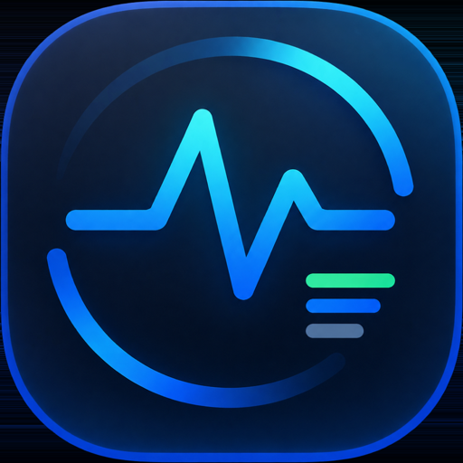
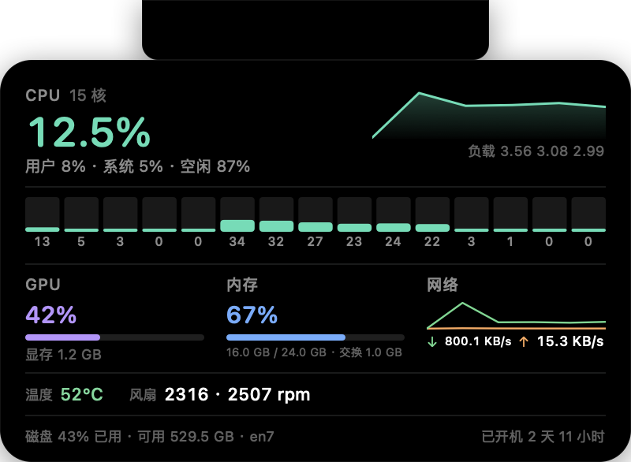
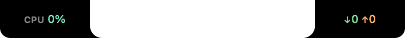
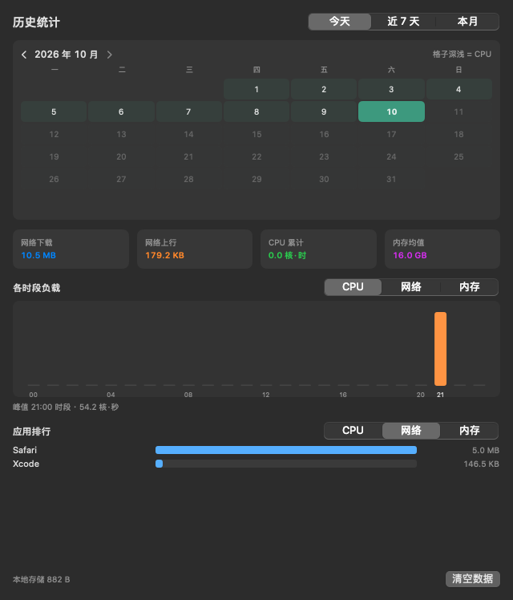

# LiteStats




**A lightweight system monitor that lives in the MacBook notch.**

Hover the notch and a panel drops down with CPU, GPU, memory, network, disk, temperature and fans.
Move away and it tucks itself back in — no menu bar space, no Dock icon.

*[中文说明 →](README.zh-CN.md)*



## Features

- **Hidden in the notch** — the collapsed state blends into the notch itself, pixel by pixel
- **Hover to open** — the panel drops down quickly; click to pin it open
- **Everything at a glance** — CPU (total + per core), GPU, memory, network, disk, temperature, fans
- **Optional indicators** — show one metric on each side of the notch while collapsed
- **External displays too** — screens without a notch get a small always-visible pill at the top center
- **Local history** — a calendar of past days, hourly load and per-app usage, stored only on your Mac
- **Light on resources** — roughly 0.1% CPU and 16 MB of memory at idle
- **English / 简体中文** — follows the system language, switchable in Settings
- **No dependencies** — pure Swift and system frameworks

| Indicators | Collapsed pill (external display) | History |
| --- | --- | --- |
|  |  |  |

## Requirements

macOS 14 or later, Apple Silicon.

## Install

1. Download `LiteStats-1.3.0.dmg` from [Releases](https://github.com/alanhaskey/LiteStats/releases)
2. Open it and drag **LiteStats** into *Applications*
3. Launch it — the app runs in the background with no Dock icon

> The app is not code-signed or notarized, so on first launch macOS asks you to confirm:
> **right-click the app → Open**, or run
> `xattr -d com.apple.quarantine /Applications/LiteStats.app`

## Usage

| Action | Result |
| --- | --- |
| Move the pointer to the notch | Panel expands; data refreshes every second |
| Move the pointer onto the panel | It stays open while you read |
| Move the pointer away | Panel collapses and sampling slows down |
| Click the notch or the panel | Pins it open (click again to unpin) |
| Menu bar icon | History (⌘H) · Settings (⌘,) · Quit (⌘Q) |

**Settings** let you choose which metric (if any) sits on each side of the notch, how wide those
sides are, how often data refreshes, which display the panel uses, and whether to launch at login.

**History** opens a window with today's hourly load, a calendar for browsing past days, and a
per-app ranking by CPU, network or memory. You can clear it whenever you like — nothing leaves
your Mac.

## Build from source

Only SwiftPM is required; there is no Xcode project.

```bash
git clone https://github.com/alanhaskey/LiteStats.git
cd LiteStats
./scripts/build-app.sh release
open "dist/LiteStats.app"
```

Useful scripts: `./scripts/run.sh` (run in the foreground), `./scripts/test.sh` (unit tests),
`./scripts/run.sh --selftest` (headless self-check).

## Learn more

Implementation notes, measured numbers and the pitfalls found along the way live in
[docs/architecture.md](docs/architecture.md).

## License

[MIT](LICENSE) © 2026 alanhaskey

Temperature and fan readings rely on undocumented Apple HID sensors. They are optional — if the
system does not report them, LiteStats simply shows nothing.
